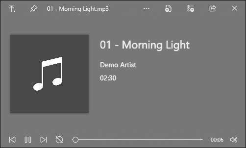

# QuickLook.Plugin.PlaylistNav

Adds Previous and Next buttons to the [QuickLook](https://github.com/QL-Win/QuickLook) media player, so you can go through a folder of songs without leaving the preview.

- Previous/Next jump to the next audio file in the same folder (or video, if you're previewing a video)
- Same order as Explorer's name sort
- Loops back to the first file after the last one
- The selection in Explorer follows along

It reuses QuickLook's own player, so cover art, lyrics, loop and volume work as before.

## Install

Download `QuickLook.Plugin.PlaylistNav.qlplugin` from [Releases](../../releases/latest), select it in Explorer, press Space and click "Click here to install this plugin", then "Restart now".

Tested on QuickLook 4.5.0 (installer and Microsoft Store versions).

To uninstall, delete the `QuickLook.Plugin.PlaylistNav` folder and restart QuickLook. It's in:

- `%APPDATA%\pooi.moe\QuickLook\QuickLook.Plugin\` (installer version)
- `%LOCALAPPDATA%\Packages\21090PaddyXu.QuickLook_egxr34yet59cg\LocalCache\Roaming\pooi.moe\QuickLook\QuickLook.Plugin\` (Store version)

## Build

Needs the .NET SDK. Run `.\pack.ps1`, the plugin ends up in `dist\`.

`lib\QuickLook.Common.dll` comes from a QuickLook 4.5.0 install and is only used to compile.

## License

GPL-3.0, same as QuickLook.
